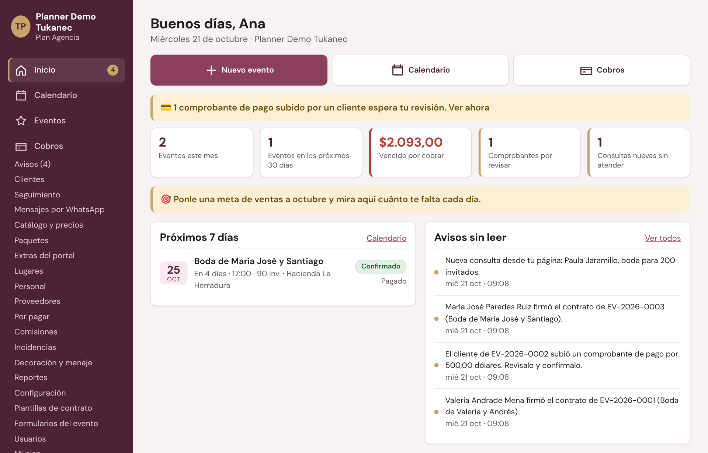
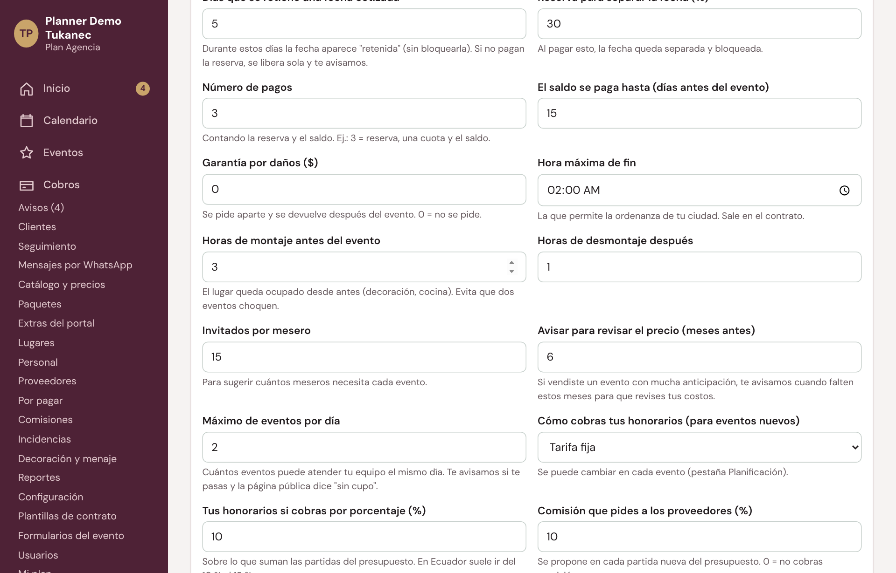
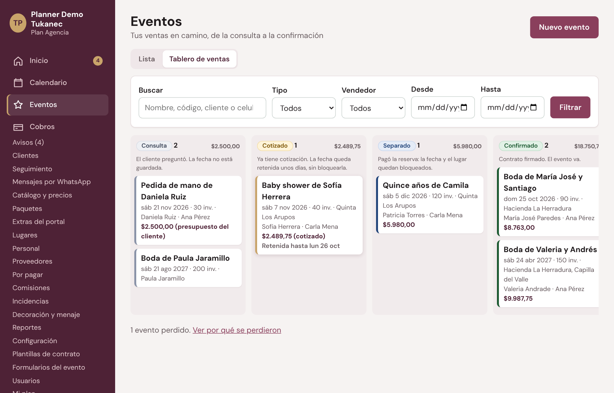
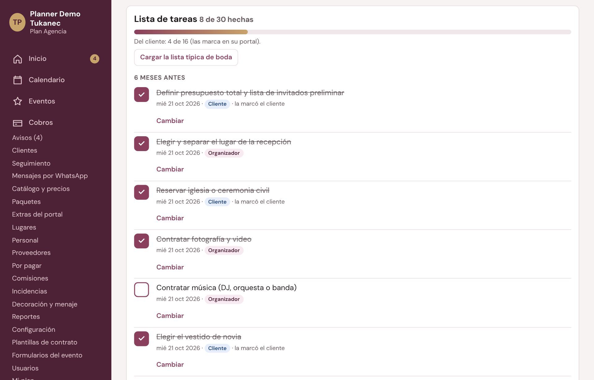
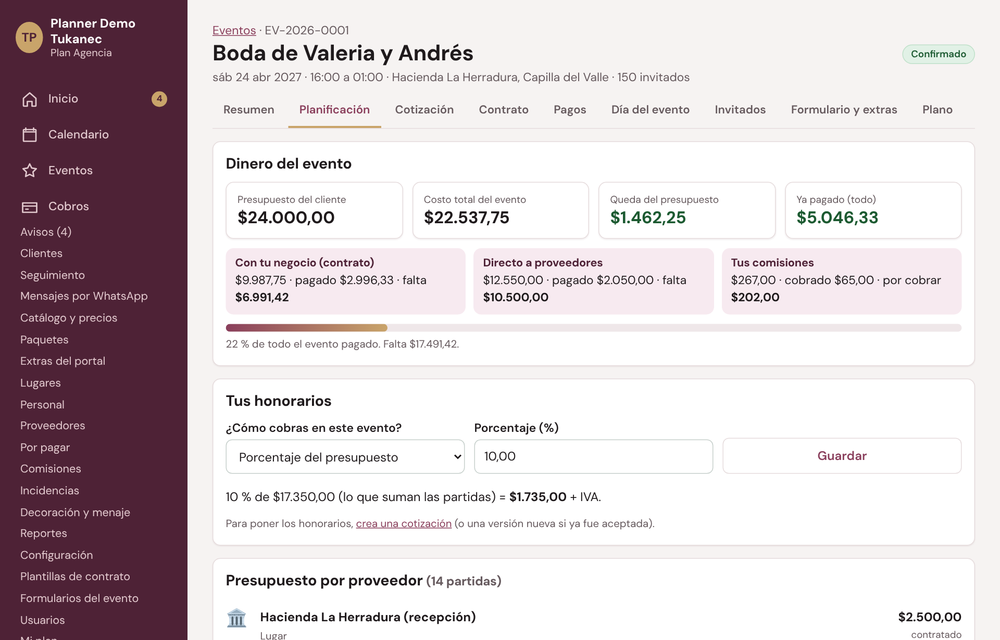

# Manual de TuPlanner (por módulo)

Versión completa con capturas: [Manual_TuPlanner.pdf](Manual_TuPlanner.pdf) (35 páginas). Las capturas están en [manual/capturas](manual/capturas) y salen del negocio de ejemplo «Planner Demo Tukanec».
Entrar: **tuplanner.tukanec.com** con tu correo y tu contraseña. Ayuda: WhatsApp 099 640 8397 · info@tukansoftware.com · tukansoftware.com.

Cada parte dice si es de la **base** (la tienen todos) o de un **módulo** (se enciende en Mi plan). Si un módulo no está en tu plan, su pantalla dice «Este módulo no está en tu plan» con el botón **Ver Mi plan**. Apagar un módulo no borra nada.

Para regenerar el manual (base de ejemplo, capturas y PDF): `bash docs/manual/generar/generar.sh` (o `SOLO_PDF=1` para rehacer solo el PDF).

---

## La base

### Entrar y el Inicio
- Correo y contraseña → **Entrar**. En el celular, abajo: Inicio, Calendario, Eventos, Cobros y **Más**.
- El Inicio muestra comprobantes por revisar, cifras, próximos 7 días, avisos, seguimientos, tareas y cuotas.
- Cuenta nueva: guía **Primeros pasos** (datos del negocio, logo, lugares y precios, primer evento).

### Usuarios y roles (Más → Usuarios)
| Rol | Qué puede hacer |
|---|---|
| Dueño | Todo, incluida la configuración, los usuarios y el plan |
| Administrador (hasta 4) | Lo mismo que el dueño: menú, usuarios, configuración, Mi plan, metas y dinero. Crea, cambia y desactiva a otros administradores y usuarios. **No cuentan** en el límite de usuarios del plan. No puede cambiar ni desactivar al dueño, ni a sí mismo |
| Vendedor | Atiende consultas, cotiza, hace contratos y registra cobros |
| Coordinador | Organiza el día del evento; ve tareas e ideas; no ve dinero |
| Solo consulta | Ve todo pero no cambia nada (contador, socio) |

- **Más → Usuarios** (dueño o administrador) → **Agregar a alguien** → ¿Qué va a hacer?: **Administrador (mismos permisos que el dueño)**, Vendedor, Coordinador o Solo consulta. Arriba dice «Administradores: 2 de 4».
- **Administradores:** hasta 4 además del dueño; un quinto (al crear o activar) muestra «Puede tener hasta 4 administradores además del dueño». No cuentan en el límite de usuarios del plan (el dueño sí cuenta); si un administrador pasa a otro rol, empieza a contar.
- **Solo del dueño:** ser la cuenta registrada en Tukán (contacto del negocio en el Panel Tukán Central y «Nueva clave del dueño» desde Tukán). Nadie, ni un administrador, cambia ni desactiva al dueño; nadie se cambia el rol ni se desactiva a sí mismo.
- En este manual, «solo el dueño» vale también para los administradores.

### Configuración (dueño y administradores)
Pestañas Negocio, Reglas, Cobros en línea, Página pública, Tareas, Google Calendar (módulo Exportar) y Más. En **Reglas**: IVA, validez de la cotización, retención de la fecha, reserva para separar, número de pagos, **máximo de eventos por día**, **cómo cobras tus honorarios** (tarifa fija o porcentaje) y **comisión que pides a los proveedores**.

### Lugares, catálogo y plantilla de tareas
- **Lugares**: quintas, haciendas e iglesias con tipo, dirección, mapa y contacto; fechas cerradas.
- **Catálogo y precios**: tus honorarios («Organización») y lo que revendes; subir precios en bloque.
- **Configuración → Tareas**: la lista que se copia a cada evento, para el Organizador o el Cliente, con días antes del evento.

### Eventos
Estados: consulta → cotizado (fecha retenida) → separado (pagó la reserva, el lugar queda bloqueado) → confirmado (contrato firmado) → realizado; o perdido / cancelado con motivo. **Nuevo evento**: cliente, qué celebran, fecha, invitados, lugares (o «Lugar por definir») y presupuesto del cliente.

### Cotización, pagos y cobros
- **Cotización**: desde un paquete, copiando la anterior o en blanco; enlace para que el cliente la acepte; al aceptar se arma el plan de pagos.
- **Pagos** del evento: registrar pago con recibo (la reserva separa la fecha sola), comprobantes por revisar, garantía, gastos y ganancia.
- **Cobros**: cuotas vencidas y por vencer, comprobantes y garantías por devolver.
- **Seguimiento** y **Mensajes por WhatsApp de hoy**.
- **Reportes**: ventas, cobrado, por cobrar y ocupación.

---

## Módulos del organizador

### Planificación
Pestaña **Planificación** → Lista de tareas por meses («6 meses antes»… «Después del evento»), del Organizador o del Cliente (la marca en su portal). **Cargar la lista típica**, **Nueva tarea**, **Cambiar**.

### Presupuesto por proveedor (necesita Planificación)
- **Repartir con los porcentajes típicos** arma las partidas de una boda, unos quince años u otro evento.
- Cada partida: proveedor, estado (Idea, Pidiendo precios, Contratado, Descartado), estimado, contratado, **quién le paga** (el cliente directo o «va en nuestro contrato», que el cliente no ve) y pagos del cliente.
- **Dinero del evento**: presupuesto del cliente, costo total, lo que queda, lo pagado al negocio y a proveedores.

### Honorarios y comisiones
- **Tus honorarios**: tarifa fija o porcentaje del presupuesto → **Poner en la cotización**.
- **Comisiones de proveedores** (necesita Presupuesto): % o fijo por partida contratada; **Más → Comisiones** con Por cobrar (Recordarle por WhatsApp, Ya me pagó) y Cobradas por periodo.

### Ideas e inspiración
Temática, paleta de colores y tablero de fotos (❤️ Va / ✕ No va); el cliente sube las suyas en su portal.

---

## Otros módulos
Paquetes y simulador · Contratos con firma (firma con el dedo, QR de verificación, anexos) · Portal del cliente (sin claves: evento, documentos, pagos, Tu planificación, ideas) · Cobros en línea (Payphone) · Formulario, extras y encuesta · Día del evento · Invitados con QR · Plano del salón · Mobiliario y menaje · Boda en vivo · Proveedores y compras · Portal del proveedor · Incidencias y puntaje · Metas y reportes avanzados · Avisos por Telegram · Exportar a Excel y Google Calendar.

## Mi plan y demos
- **Más → Mi plan**: módulos encendidos, los que puedes agregar («Precio por cotización» y **Pedir cotización**) y lo que viene siempre incluido.
- No hay registro abierto: **Solicitar demo**. Tukán crea la demo; al contratar, nada de lo cargado se pierde.
- El valor del programa siempre es por cotización según los módulos: WhatsApp 099 640 8397.
